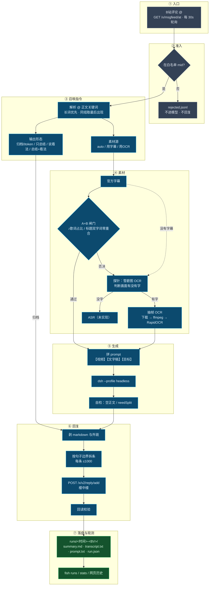

# dsh-bili-fish

**你 @ 它，它读懂那个视频，回你一段带判断的看法。**

不刷 B 站、不选片、不闲逛、没有人设、没有日记——只在被叫时才动。

字幕优先；字幕如果是 BGM 歌词，会自动落回画面 OCR；两种都拿不到就老实说读不了。
在 @ 里写「用字幕」「用OCR」「用ASR」「只拉文字版」「悄悄」可以强制指定处理方式。
回复前会剥掉 markdown、按句子边界拆条、发完回读确认——因为 B 站评论区不渲染 markdown，单条上限 1000 字。

附带一个只监听 `127.0.0.1` 的本地控制台：配置可视化编辑、回复历史、召唤指令词表、架构图。

设计细节见 [docs/设计定稿.md](docs/设计定稿.md)，换机器先看 [docs/新机器部署.md](docs/新机器部署.md)。

---

## 它长什么样

一个常驻进程 + 一个本地控制台。

**常驻进程**（`fish-serve.cmd`）：每 30 秒拉一次 B 站 @ 消息，白名单准入 → 生成 → 回到楼中楼。

**本地控制台**（`fish-web.cmd`）：只监听 `127.0.0.1`，带一次性 token，四个 Tab——

| Tab | 内容 |
|---|---|
| **配置** | `config.json` 可视化编辑。十个分组默认折叠，点标题展开；表单和原始 JSON 双轨，保存前自动备份 `config.json.bak`，未知字段原样保留 |
| **历史记录** | 每次回复的完整记录：时间 / BV / 标题 / 结果 / 字数 / 回复 rpid / 运行目录。点开一行能看到当次运行的 `summary.md`、文字稿前 6000 字、元数据和文件清单 |
| **召唤指令** | 说明表 + 可编辑词表。在 @ 里写关键词就能改变这一条的处理方式（见下） |
| **架构图** | 从 @ 到落盘的 7 个阶段，每个盒子下面标着对应的文件，能直接和代码对上 |

### 召唤指令：在 @ 里写关键词

在 @ 的那句话里带上关键词，就能改变这一条的处理方式——强制用字幕还是用画面、
只要总结还是只要看法、甚至完全不调模型只拉文字稿。词表在网页里可改，**serve 下一轮自动生效**。
完整词表见下面[「召唤指令」](#召唤指令2026-11-06)一节。

---

## 现在到哪一步了

| 阶段 | 内容 | 状态 |
|---|---|---|
| **M0** | `fish see <BV>` 盘点全部素材 + 判定走哪条腿（字幕优先） | ✅ 完成 |
| **M1** | `fish summary <BV>` → 极简 prompt → 生成 → 自检 → 写本地文件 | ✅ 完成 |
| **M5-lite** | 无字幕文字屏 → 下载 1080P → 抽帧 → OCR → 行级去重 → 同构时间轴 | ✅ 完成 |
| **M2/M3** | msgfeed 轮询 + 白名单准入 + 生成 + 回复到楼中楼 + 幂等/熔断/重试 | ✅ 完成 |
| **M6** | 超长正文拆成多条楼中楼 | ✅ 完成 |
| M4 | ASR：无字幕 + 横屏口播类 | 待做 |

**回复是唯一会写 B 站的动作**，且只在被 @ 时、且对方在白名单里才会发生。

---

## 输出长什么样（2026-11-06 简化）

**不规定格式、不规定字数。** prompt 只有三块：

```
【视频】      标题 / UP主 / 时长 / 播放·弹幕·评论
【文字稿】    来源 + 覆盖率 + 带 [MM:SS] 的逐行素材
【提问者的话】 只在提问真的说了什么时才出现（剃掉 @ 和关键词，≥15 字）
【目标】      说说你怎么看
```

不写"分两段"、不写"用数字分点"、不写"600-800 字"、不列禁用词——怎么写由模型自己定。

**只有一条硬约束来自 B 站：单条评论 1000 字上限。** 处理方式是拆分，不是重写：

| 正文长度 | 行为 |
|---|---|
| ≤ 1000 | 照旧发一条 |
| 1001 – 2000 | 在**句子边界**（。！？；换行）切成 2 条、尽量均分，每条 ≤1000；同一条楼中楼，第一条发完**隔 10-20 秒**发第二条 |
| 2001 – 3000 | 2 条装不下 → 3 条 |
| > 3000（极端） | 最多 3 条，仍装不下就截断末条并在日志里说明 |

句子边界实在满足不了"每条 ≤1000"时，退到逗号 → 空格 → 按目标字数硬切（只会切在两条中间附近）。

拆出来的每一条 `parent` 都是**原 @ 评论的 rpid**（两条是兄弟楼层）：
不依赖上一条返回的 rpid，也不会形成"回复自己"的链或加深楼层。

自检（`lib/compose.mjs` 的 `selfCheck`）现在**只把空正文判为不通过**；
超 1000 只标 `needSplit`（交给回复层拆），AI 腔 / 假装看过画面 / 时间戳只记 `warnings`，不再触发重试。

### 平台适配：发出去之前会把 markdown 洗掉

prompt 变简单之后，模型自然会用 `## 小标题`、`**加粗**`、`[文字](链接)` 来组织内容。
**B站评论区不渲染 markdown**，而且模型会补素材里没有的外链（实测补过一篇经济观察网）。

所以回复层加了一道 `toBiliPlainText()`（`lib/reply.mjs`，纯函数、幂等），在拆分**之前**跑：

| 模型写的 | 发出去的 |
|---|---|
| `## 一、结论` | `一、结论` |
| `**重点**` / `*强调*` / `~~废弃~~` | `重点` / `强调` / `废弃` |
| `[经济观察网](https://…)` | `经济观察网`（URL 整个丢掉） |
| `` `code` `` / ``` 围栏 | `code` / 整行删掉 |
| 行首 `- ` `* ` `+ ` | `· `（数字编号 `1.` 保留） |
| `> 引用` / `---` | 去掉符号 / 整行删掉 |

`summary.md` 里落的仍然是**模型原文**（带 markdown），只有发到 B 站的那份是洗过的。

拆分时还会避免**把数字或英文单词切两半**——`…规划约 1.3 万颗` 不会变成 `…规划约 1.` / `3 万颗`。

---

## 召唤指令（2026-11-06）

@ 正文里带关键词，就能**强制**改素材源和输出形态——不用改配置，也不用手敲命令。
解析在 `lib/routing.mjs`，**只读被 @ 的那一条评论正文**，不碰别的消息、标题或字幕。

### 词表

**每组只留一个词**（2026-11-06 收词）。同义词全删——用学习成本换精确性：
「文字稿」「你怎么看」这类日常高频词太容易误撞，一次误命中就改错处理方式。

| 维度 | 关键词 | 效果 |
|---|---|---|
| 素材源 | `用字幕` | 官方字幕（**跳过 A+B 闸门**） |
| 素材源 | `用OCR` | 画面 OCR（**完全不看字幕、不跑探针**） |
| 素材源 | `用ASR` | 语音转写（**字幕和画面都不看，只下音轨**） |
| 输出形态 | `只拉文字版` | 归档，**不调模型**，0 token |
| 输出形态 | `只要总结` | 【目标】总结这条视频讲了什么 |
| 输出形态 | `说说看法` | 【目标】说说你怎么看（默认） |
| 输出形态 | `总结加看法` | 【目标】先总结，再说说你怎么看 |
| **是否公开** | `悄悄` | **静默**：一个字都不发评论区，只落本地和网页历史 |

前三个是同一个维度（素材源，互斥）、中间四个是另一个维度（输出形态）、最后一个是第三个维度——**可以任意组合**：

```
@它 悄悄 用OCR 只要总结 这个视频说得对吗
    └─静默  └─素材源  └─输出形态  └─这句会进【提问者的话】
```

词表在 `config.json` 的 `routing.keywords`（默认值见 `lib/config.mjs`），可以自己加。匹配规则：

- **归一化**后匹配：全角转半角、大小写不敏感、空白全去掉 —— `用ＯＣＲ` = `用 ocr` = `用OCR`
- **长词优先**：按长度降序匹配，命中后把那段"吃掉" —— `总结加看法` 不会被拆成更短的词
- **最后说的算**：同一组多个词都出现 → 取最后出现的那个；素材源 / 输出形态也是各取最后命中
- 没命中任何词 → `auto` + `view`，行为和以前**完全一样**

### 关键词之外，你写的话也会进 prompt

关键词只决定「怎么处理」，评论里**剩下的内容**决定「回答什么」。

```
你说：@它 用OCR看看这个视频说的对吗，我感觉稍微有点奇怪
      按合作者的思路去面试会更有效吗
      另外普通人最大的护城河还是钱吧，对吗

剃掉：@它       （称呼）
剃掉：用OCR     （指令，留给代码）
剩 56 字 → 原样进 prompt 的【提问者的话】
```

- 剃完不足 **15 字**（`routing.askMinChars`）就当作纯召唤语，不传——「看看这个」不会变成 prompt 里的一句废话
- 这一节放在【目标】**前面**，最后一句仍然是「说说你怎么看」，所以模型还是"给看法"，不会退化成逐条答题
- 剃的只有三样：`@昵称`、命中的关键词、剃完留下的连续空白与孤立标点。**「帮我看看」这类语气词保留**

> **这一版只认「被 @ 的那一条」评论。** 你在自己楼里追加的追问，系统看不到。

### 静默模式（`悄悄`）

写 `悄悄`，**这条就一个字都不发到评论区**——`summary.md` 照常落本地，网页历史里多一条「静默」记录。

```
@它 悄悄 用OCR 这个视频说的对吗
```

| 项 | 静默时的行为 |
|---|---|
| 评论区回复 | **不发**，一条都不发（连归档的状态句也不发） |
| 模型 | **照常调用**（你要看内容，不调哪来的内容） |
| 失败 | **也不回**，只写 `alerts/ALERT-<rpid>.md` |
| 每日额度 | **照算**——不给静默开后门 |
| 网页历史 | `result = 'quiet'`，单独一个筛选页签 |

**用它的场景**：你不想让某个博主的评论区里出现「AI 长文」，但又想自己看看这条视频到底在说什么。

> ⚠️ **静默只藏 AI 的输出，藏不住你的 @。** 你那条 `@它 悄悄看看这个` 是公开评论，博主和所有人都能看见。
> 想彻底不露痕迹，只能自己删掉那条 @ 评论。

### 四种输出形态（`--mode`）

| mode | 【目标】那行 | 调模型 |
|---|---|---|
| `archive` | （没有 prompt） | **不调**，0 token |
| `summary` | 总结这条视频讲了什么 | 调 |
| `view`（默认） | 说说你怎么看 | 调 |
| `both` | 先总结这条视频讲了什么，再说说你怎么看 | 调 |

归档模式把**完整文字稿**（逐句，保留 `[MM:SS]` 时间戳，和 `transcript.txt` 内容一致）写进
`summary.md` 的正文区；`run.json` 记 `mode: "archive"`、`tokens: 0`、`ms: 0`。

评论正文 = 状态行 + 换行 + 文字稿全文。超过 3000 字（3 条容量）时，在**句子边界**截断到 3000 以内，
末尾加 `…（全文已存本地，评论区只贴前 N 字）`。

### 三种素材源（`--source`）

| source | 行为 | 拿不到时 |
|---|---|---|
| `auto`（默认） | 有字幕就字幕，没有就按探针判定 | 走原来的保底 |
| `subtitle` | 跳过 A+B 闸门，直接用官方字幕 | 抛错 `这条视频没有字幕轨（你要求用字幕）` |
| `ocr` | 完全不看字幕，探针 + 抽 1080P 帧 OCR | 抛错 `画面里没读到文字` |

强制素材源时**不读也不写素材缓存**：不读是因为缓存里可能是另一种素材（缓存是字幕、你偏要 OCR），
不写是因为一次强制 OCR 会把字幕视频的缓存污染成 OCR，以后 `auto` 模式就再也用不上字幕了。
代价是强制 OCR 每次都要重新下载 + 抽帧（这是"强制"该付的钱）。

### 状态行长什么样

命中关键词时，回复的**第 1 条开头**会加一行（不是单独一楼，所以算进 1000 字额度）：

```
命中「只要总结」关键词，跳过自动检验。
```

归档模式再多一句后果：

```
命中「只拉文字版」关键词，跳过自动检验。使用归档模式，已拉取完整文字稿：画面OCR 112 句 / 约 2094 字，已存本地。
```

失败重试 3 次仍失败时，回给用户的是**控制台那句错误原文**（例如 `✗ BV1QjuQ6REcS 这条视频没有字幕轨（你要求用字幕）`），
不再让模型编一句道歉。白名单 / 额度跳过照旧**不回**。

手动跑也一样：`node bin/fish.mjs summary <BV> --source ocr --mode summary --dry`。

---

## 架构

从「有人 @ 它」到「落盘可查」，一共 7 段。每个阶段下面标着对应文件，图和代码能对上。



对应文件：

| 阶段 | 文件 |
|---|---|
| ① 入口 / ② 准入 | `lib/serve.mjs` · `lib/feed.mjs` · `lib/bili.mjs` · `lib/store.mjs` |
| ③ 召唤指令 | `lib/routing.mjs` · `lib/config.mjs` |
| ④ 素材 | `lib/media.mjs` · `lib/subtitle-check.mjs` · `lib/probe.mjs` · `lib/ocr.mjs` · `lib/asr.mjs` · `python/probe.py` · `python/ocr.py` · `python/asr.py` |
| ⑤ 生成 | `lib/compose.mjs` · `lib/model.mjs` |
| ⑥ 回复 | `lib/reply.mjs` · `lib/bili.mjs` |
| ⑦ 落盘 | `lib/runs.mjs` · `web/server.mjs` |

> 网页控制台的「架构图」Tab 画的是同一张图（纯 HTML/CSS，不依赖外部资源）。

### 素材三级的级联

一条视频到底走哪条腿，是**逐级降级**的，不是二选一：

| 顺序 | 用的是什么 | 什么时候用 | 成本 |
|---|---|---|---|
| 1 | **官方字幕** | 有字幕轨，且通过 A+B 闸门（不是歌词、跟标题对得上） | 几秒 |
| 2 | **抽帧 OCR** | 没字幕 / 字幕被否决 / 你写了「用OCR」 | 下载整片 + 逐帧识别，约 1 分钟 |
| 3 | **语音转写** | 前两级都拿不到足够文字 | 只下音轨（1-2MB）+ 转写，约 1-7 分钟 |

第 3 级的触发条件有两个：

- 判定就是 `asr`（没有字幕，探针说画面也没字）
- **OCR 跑完但只读到很少的字**（默认 < 80 字，`asr.ocrFallbackMinChars` 可调）——画面没字，那就只能听了

> 强制指定时（`用字幕` / `用OCR`）**不走级联**：用户点名的路走不通就如实报错，不偷偷换路。
>
> **音质说明**：中文口播用 `small` 模型，实测 22 分钟课程转写 424 秒（约 0.3× 实时）。
> 代价是专业词容易错（实测「函数」→「寒树」、「高等数学」→「高顿数学」）。
> 想要更准就改 `config.asr.model` 为 `medium` 或 `large-v3`（模型更大、更慢）。
> 所以这条腿只当兜底用——有字幕或画面有字时，永远不会走到它。

---

## 依赖

| 依赖 | 必需？ | 缺了会怎样 |
|---|---|---|
| Node 20.11+ | 必需 | 跑不起来（用了 `import.meta.dirname`） |
| DSH 本体（`@deepseek-ai/dsh`） | 必需 | 生成必失败；路径不在候选里时设 `BILI_FISH_DSH_BIN` |
| `DEEPSEEK_API_KEY` | 必需 | 生成必失败（`MISSING_CREDENTIAL`） |
| Python 3.10+ | OCR 用 | 探针跳过，判定退回"保底 OCR" |
| `pip install -r requirements.txt` | OCR 用 | 同上 |
| ffmpeg | OCR 用 | 抽帧不了，OCR 那条腿废掉 |
| faster-whisper | ASR 用（未实现） | 现在不影响 |

**设计原则：缺任何一环，鱼都还能跑，只是那一环降级。** 不会因为没装 ffmpeg 就整体不动。

**换机器请照 [docs/新机器部署.md](docs/新机器部署.md) 走一遍**——那里有逐项清单和常见故障对照。

---

## 实测数据（不是估计）

带登录态采样 24 条热门视频：

| 项 | 结果 |
|---|---|
| 有字幕 | **75%（18/24），全部是 B站 AI 生成的 `ai-zh`，人工字幕 0** |
| 无字幕 | 25%（6/24），集中在音游/GMV/宅舞/影视剪辑/三农/搞笑 |
| 雪碧图 | 匿名可用，480×270，5-6 秒/帧，89 分钟视频 7.5 MB |
| 探针分档 | PPT 类 **115-195 字/帧** vs 有字幕类 **9-16 字/帧**（差一个数量级） |

**所以默认路径是：先看有没有字幕（75% 命中），没有才跑探针。**

## 过程文档（每次运行全落盘）

每次 `see` / `summary` 都会建一个目录：

```
~/.dsh/bili-fish/runs/
├─ index.jsonl                      ← 每行一次运行（统计页面读这个）
└─ 20261104-133729-BV1Zssf64EEu/
   ├─ see.json                     本次盘点的原始结果
   ├─ material.json                喂给模型的素材快照（字幕/OCR 的每一行 + 时间）
   ├─ prompt.txt                   实际发给模型的完整 prompt
   ├─ summary.md                   最终输出（含元数据头）
   └─ run.json                     结构化元数据（耗时/tokens/自检/会话/重试次数/source/mode）
```

归档模式（`--mode archive`）**没有 `prompt.txt`**——根本不调模型；`run.json` 里 `tokens: 0`、`ms: 0`。

**找不到产物时用这个**（会打出完整路径）：

```powershell
node bin/fish.mjs runs              # 全部产物，倒序
node bin/fish.mjs runs BV1Nixm65EVE # 只看某一条
```

看统计：

```powershell
node bin/fish.mjs stats
```

```
一共问了 3 次

按天：
  2026-11-04  ███ 3

按素材：
  subtitle   2
  ocr        1

累计输出 190 字 · 累计 token 9819
```

**注意**：`runs/` 是持久记录，不会自动清；`cache/` 是临时素材（视频/帧/雪碧图），可以随时删。

> 早期版本的产物直接在 `cache/<BV>/summary-*.md`，与 `runs/` 并存过一段。已用
> `node tools/migrate-cache.mjs` 统一迁到 `runs/`（迁移脚本带 `--dry` 和备份约定，可复用）。

## 数据放哪 / 怎么搬到别的盘

数据目录默认是 `~/.dsh/bili-fish`（Windows 即 `C:\Users\<你>\.dsh\bili-fish`），可以用环境变量改：

```powershell
$env:BILI_FISH_HOME = "D:\somewhere\bili-fish-data"
```

**但真正会吃盘的是 `cache/`**——跑一次 OCR 要下 1080P，一条 90 分钟的视频就是 **544 MB**。
如果 C 盘紧张，建议整体挪走，并**用目录联接接回来**（不需要管理员，也不影响任何调用方）：

```powershell
robocopy "$env:USERPROFILE\.dsh\bili-fish" "D:\path\bili-fish-data" /E /COPY:DAT
Remove-Item "$env:USERPROFILE\.dsh\bili-fish" -Recurse -Force
New-Item -ItemType Junction -Path "$env:USERPROFILE\.dsh\bili-fish" -Target "D:\path\bili-fish-data"
```

> 本机就是这么做的：`C:\Users\<你>\.dsh\bili-fish` 现在是个 **Junction**，
> 指向 `D:\00000\aiStudy\bili-fish-data`，C 盘占用 0 KB。

## 字幕可用性闸门（A+B）

**字幕拉到了 ≠ 能用。** B站 的 AI 字幕有可能只是背景音乐歌词，或者跟标题完全对不上。
实测 `BV1xfxU67Ets`（斗地主那期）：45 行字幕 **100% 带 ♪**，全是歌词，真正的分析内容在画面文字里。

所以现在拿字幕之前先过两道纯文本判据（不花任何网络/OCR 成本）：

| 判据 | 触发条件 |
|---|---|
| **A. 歌词记号** | `♪ ♫ 🎵 🎶` 占字幕行数 > 20% |
| **B. 标题对不上** | 标题拆成双字词，字幕里命中的比例 = 0（要求标题 ≥8 个双字词、字幕 ≥100 字，避免误杀短视频） |

任一命中 → **不直接采用字幕**，强制跑探针看画面有没有字：
- 探针判 OCR 且画面字数够 → 改用画面文字（日志会写「字幕被否决 → 改用画面文字」）
- 探针判 ASR（画面也没字）→ 如实失败，不硬编

> 参照：`dsh-bili-watch` 有「反钓鱼自查」，但用**语速**判（2.0–8.5 字/秒）。
> 这条视频语速 3.0 字/秒，完全在正常区间，它的判据抓不到；`♪` 占比是 100%，一抓就中。

## 常驻进程：被 @ 就回复（M2 + M3）

双击 **`fish-serve.cmd`** 即可。它会每 30 秒拉一次 @ 消息，然后：

```
@ 消息 → 白名单闸门 → 排队（最多 5）→ 生成 → 超 1000 拆条 → 回复到楼中楼 → 回读校验
```

启动时窗口里会打出白名单 mid、忽略过的非白名单 @ 数量、以及未处理的失败告警。

**调试**：`fish-once.cmd` 只跑一轮就退出，并问你要不要真发（直接回车 = 演练）。

| 约束 | 值 | 说明 |
|---|---|---|
| 轮询间隔 | 30 秒 | `config.serve.pollSec` |
| 每日上限 | 50 条 | `limits.dailyReplies` |
| 同视频每日 | 3 条 | `limits.perVideoPerDay`，防在一个楼里刷屏 |
| 队列上限 | 5 条 | `limits.queueMax`，超了记 `rejected.jsonl` |
| 单条超时 | 20 分钟 | `limits.taskTimeoutMin`，超时写告警 |
| 失败重试 | 3 次 | 之后写 `alerts/ALERT-<rpid>.md`，不再自动重试 |
| 白名单 | `whitelist` 里的 mid | 非白名单**连素材都不取**，只记 `rejected.jsonl` |
| 幂等 | `rpid` | B站 回完不撤消息，只能自己记（`handled.jsonl`） |

**落盘位置**（都在家目录）：

```
handled.jsonl     已处理的评论（幂等依据）
rejected.jsonl    被拒绝的（非白名单 / 队列满）
attempts.json     每条失败了几次
alerts/           连试 3 次仍失败的任务，一个文件一条
cache/<BV>-<cid>/material.json   素材缓存（30 天），重跑只重算模型那部分
```

**风控**：遇到 `-352` / `-412` 会**熔断 24 小时**，期间只读不写；`12051`（重复评论）视为成功。

## 用

```powershell
# 盘点一条视频（只读）
node bin/fish.mjs see BV1Q84c6REAK

# 生成一条总结评论，只写到本地文件（不会发出去）
node bin/fish.mjs summary BV1REx46NEc4

# 只看 prompt 不调模型
node bin/fish.mjs summary BV1REx46NEc4 --dry

# 追加一句额外要求
node bin/fish.mjs summary BV1REx46NEc4 --ask "重点讲 PTC 那段"

# 跳过 OCR 探针 / 原始 JSON
node bin/fish.mjs see BV1Q84c6REAK --no-probe
node bin/fish.mjs see BV1Q84c6REAK --json

# 召唤指令：强制输出形态 / 强制素材源
node bin/fish.mjs summary BV1Nixm65EVE --mode both
node bin/fish.mjs summary BV1Nixm65EVE --source ocr --dry
node bin/fish.mjs summary BV1Nixm65EVE --mode archive   # 0 token，只落文字稿
```

输出示例：

```
  标题   2026年10月一周时政 第5周（二十届五中全会）时政热点 图文讲解联系政治理论更好记忆
  时长   38:26   1920x1080

  ✓ danmaku        177ms  6 条（标称 6）749 B 原始
  ✓ playurl         83ms  quality=64 · durl 108.1 MB
  ✗ subtitle        64ms  B站 API -101: 账号未登录
  ✓ videoshot      163ms  5 张/100 格 · 480x270
  ✓ probe         7248ms  平均 115.3 字/帧 · 1734 ms/帧

  雪碧图  5 张 · 共 460 帧 · 覆盖 38:25 · 约 5s/帧
  探针    每帧字数 [18,164,164] → 平均 115.3（2.5 MB）

  ▶ 判定   OCR   115.3 字/帧 ≥ 60 → 文字屏，OCR 是主粮
```

## 作为 DSH 插件装

```powershell
dsh plugin --profile <你的profile> add link:"<本仓库绝对路径>"
# 然后完全退出 DSH（含托盘）再重启
```

装好后模型看到工具 `mcp__fish__fish_see`。

---

## 配置

`~/.dsh/bili-fish/config.json`（首次运行自动生成）。参数含义见《设计定稿》§9。

凭证放 `~/.dsh/bili-fish/credentials.json`（**没有它也能跑，只是拿不到字幕**）：

```json
{ "sessdata": "...", "bili_jct": "...", "buvid3": "..." }
```

> 凭证永不进日志、永不回显。

---

## 红线

1. 只回白名单；白名单为空 → **完全不响应**
2. 视频锚点只认 @ 所在评论区，**不猜 BV**
3. 没看全就说没看全
4. 写操作由代码执行，模型只负责写那段文字
5. 结果不确定**不重发**
6. 不记 cookie

---

## 踩过的坑（记下来免得再踩）

| 坑 | 症状 | 正解 |
|---|---|---|
| **字幕是歌词** | 总结全是"长街/美人/黑骏马"，跟标题毫无关系 | 见上「字幕可用性闸门」：`♪` 占比 + 标题双字词零命中 |
| **headless 拿不到 API key** | 每次生成都成功但正文为空 | `dsh --profile headless` 只读 credentials 的 `records` 段，老格式的 key 在 `refs` 段 → `lib/model.mjs` 兜底读 `~/.dsh/.credentials.yaml` 的 `refs.DEEPSEEK_API_KEY`，经环境变量传给子进程（不打印不落盘） |
| **final 事件带 reason=error** | 报错被当成"模型返回空正文"，白跑两次自检 | `askModel` 必须看 `ev.reason.kind === 'error'` 并 reject |
| **多 P 视频的 cid/duration 不一致** | 320P 的课覆盖率算成 0.29% | `view.cid` 只给第 1P，`duration` 是总和 → 按 `pages[p-1]` 取 |
| **config.json 带 BOM** | 改过的配置静默失效 | PowerShell / 记事本会写 BOM，读文件时先剥 |
| **Python stdin 不设 UTF-8** | `Image.open` 报文件不存在 | `sys.stdin/stdout/stderr` **三个都要** `reconfigure` |
| **忘了 await 抽帧** | OCR 说"没有帧" | `extractFrames` 返回 Promise，塞进 `JSON.stringify` 变 `{}` |
| **OCR 断行不拼** | 同一句被拆成两行 | 同帧内、上一行无句末标点且 ≥6 字 → 接上 |
| **重跑复用会话** | 输出被上一次污染 | 新生成开新会话，只有 `--ask` 复用 |
| `view.tname` 是空字符串 | 分区筛选静默失效 | 4/4 实测为空，分区名只能从 popular/搜索的 `typename` 拿 |
| 弹幕 XML 强制 deflate | 读到一堆乱码 | **即使不发 `Accept-Encoding` 也压缩**，必须手动 `inflateRawSync` |
| 雪碧图 OCR 字数准、字全错 | 拿它当正文会出笑话 | 只做探针，正文必须来自 1080P 抽帧 |
| 竖屏雪碧图无效 | 有效宽度仅 118-124px/480 | 用 `view.dimension` 直接判竖屏，跳过探针 |

## 许可

MIT。代码结构参考 [hezhaochao/dsh-video-comments](https://github.com/hezhaochao/dsh-video-comments)（MIT），
设计参考 [Alterssss/dsh-bili-whale](https://github.com/Alterssss/dsh-bili-whale) 与
[aolingge/feiyu-assistant](https://github.com/aolingge/feiyu-assistant)（均 MIT）。
